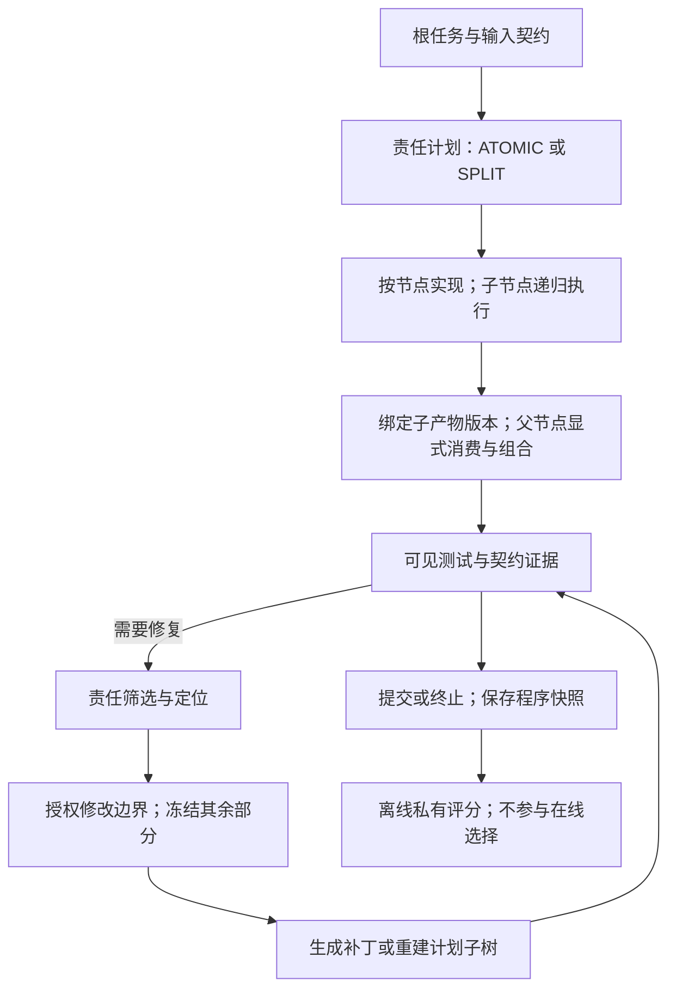

# AuditTrainer 阶段进展汇报

截至 2026 年 9 月 9 日｜已完成 A0–A6｜适用于约 10–15 分钟导师汇报

## 1. 当前进展与核心结论

**AuditTrainer 已完成从责任契约、递归代码生成、隔离验证、有界修复，到训练数据构造、QLoRA 训练和统一评测的完整研究框架，并完成第一轮核心能力对照。** 目前最明确的实验结果是：针对性的履约监督能够提高固定契约下的组件实现和父级组合能力；进一步改变父子职责分配后，成功率明显下降，暴露出模型对责任变化的适应不足。

项目已经从框架实现推进到可检验的研究问题：**模型能否按照当前契约完成分工，以及生成期形成的责任结构能否支持更可靠的后续修复。** 前一问题已有局部正向证据和明确失败诊断，后一问题进入下一阶段 A7。

| 已完成工作 | 当前规模与产物 |
| --- | --- |
| 运行框架 | 10 类动作；递归计划、模块所有权、版本绑定、显式消费、验证、代码修复与计划子树重建 |
| 机制比较 A2 | 20 个开发任务，100 次生成比较、60 次修复比较 |
| 训练数据 A4 | 50 个 TRAIN 根任务、10 个任务族、2,240 条合格动作；60 对受控对照 |
| 核心训练 A5 | F00/F10/F01/F11 四组，各 140 步；160 次能力隔离、20 次自由运行 |
| 有限修订 A6 | 替换 96 个父组合训练槽位；F11_C 从公开底座新训 140 步；40 次隔离、5 次自由运行 |
| 当前可用权重 | 5 组正式最终 adapter，合计 700 次参数更新；均已完成保存、重载与运行回接 |
| 实现验证 | 最近一次完整回归为 261 项通过；A5/A6 共 225 个开发运行完成，无评分基础设施 ERROR |

上述运行数包含同一任务在不同条件下的重复评测，不代表相同数量的独立任务。当前科学结果属于单 seed 的开发比较。

来源：[项目状态](/home/lc/AuditTrainer/STATUS.md)、[A5 汇总](/home/lc/AuditTrainer/runs/a5/result.json)、[A6 汇总](/home/lc/AuditTrainer/runs/a6/result.json)。

## 2. 研究问题：把“谁负责什么”变成可学习、可检查的对象

本项目关注代码生成中的三个相互关联的问题：分工是否明确、实现是否履约、失败后是否能在适当边界内修复。整题测试通过不能单独回答这些问题。例如，父模块可以调用子模块后丢弃其结果，再自行重算；即使最终答案正确，也不能据此认定它遵守了既定分工。

三条研究主线如下。其中 C 表示父级消费与组合，是第二条主线的一部分。

| 主线 | 模型需要具备的能力 | 当前完成程度 |
| --- | --- | --- |
| D：责任分解 | 选择整体实现或拆分；定义子契约、义务归属和数据流；说明父节点保留什么责任 | 表示、运行和监督数据已完成；尚未观察到主动形成有效 SPLIT 的学习收益 |
| I/C：契约履行与组合 | 子模块满足局部契约；父模块使用约定版本的子产物，并完成自己保留的职责 | 固定组件与双子模块组合已有明确开发收益；责任重分配仍是主要瓶颈 |
| R：责任定位与有界修复 | 根据失败证据定位责任对象，只在授权边界内修改，并检查回归 | 完整执行机制已实现；A2 有受控故障结果，训练后结构的修复价值待 A7 检验 |

**当前最有研究价值的观察，是常见组合能力与责任重分配能力之间的明显落差。** 两个子模块分别完成变换和汇总时，父节点只需传递数据；当只委托变换、把汇总留给父节点时，根任务不变，但父节点需要根据当前契约改变实现。这个比较能够直接检验模型是否适应新的职责分配。

## 3. 已完成的框架

### 3.1 一条完整执行链路

同一个 Qwen3-8B 策略服务所有递归节点。模型根据当前 observation 生成结构化动作，运行时执行状态检查、源码保存、隔离验证和预算管理。

### 3.2 各模块已实现什么

| 模块 | 已实现内容 | 对研究的作用 |
| --- | --- | --- |
| 契约与计划 | 函数签名、前置条件、输出义务、`owns/uses/must_not`；父义务映射、保留职责与数据流 | 将责任分工变成明确的模型输出和检查对象 |
| 递归运行时 | ATOMIC/SPLIT、深度优先执行、父子交接、拒收、子修复请求、弃权和预算控制 | 同一协议支持整体生成与递归生成 |
| 源码与产物 | 每节点一个源码模块；记录版本、hash、依赖和调用别名 | 将“使用哪个子实现”绑定到具体产物 |
| 显式消费与父组合 | `consume` 选择精确版本，再由模型编写父组合代码 | 可区分产物选择、实际调用和语义使用；组合仍是模型的学习任务 |
| 验证器 | Bubblewrap 隔离执行，局部/根测试，功能状态与责任状态分别记录 | 区分算法错误、接口错误、责任违规和证据不足 |
| 有界修复 | 责任候选、修复 ticket、补集冻结、可见测试重放、接受/回滚、计划子树重建 | 约束实际修改范围，并保留失败补丁和历史版本 |
| 数据与训练 | 决策前 observation → 完整 action；分桶导出、完整动作监督、QLoRA 更新和 adapter 回接 | 让分解、实现、组合及控制动作成为可训练目标 |
| 统一评测 | 首个/终止程序独立快照；全部任务分母；调用、token、验证和修复成本 | 分开评估初始生成结果与预算内最终结果 |

10 类动作是 `plan`、`write_code`、`verify`、`consume`、`reject`、`request_child_repair`、`localize`、`repair`、`finish`、`abstain`。

当前主机制采用逐节点层次契约、函数/模块所有权、精确版本消费，以及 **R1 责任筛选 + 有界修复的强制冻结约束**。根节点深度为 0，最大深度为 2，累计最多 7 个节点、每节点最多 3 个子节点；每个根任务共享最多 64 次策略调用、32 次验证/重放和 3 次补丁尝试。

责任检查按证据强度给出结论：功能通过、调用过子函数或完成 `consume`，都不自动等于责任正确。缺少适用 oracle 或语义证据时保留 UNKNOWN。训练正例主要依赖已审查构造与真实执行证据。

来源：[冻结配置](/home/lc/AuditTrainer/configs/frozen_mechanism.yaml)、[契约与动作定义](/home/lc/AuditTrainer/src/audittrainer/schema.py)、[修复实现报告](/home/lc/AuditTrainer/reports/F4.md)。

## 4. 已完成的数据与训练设置

### 4.1 数据规模与来源

当前登记了 81 个根任务：50 个 TRAIN、20 个 DEV_MECHANISM、5 个 DEV_ENGINEERING 和 6 个框架 fixture。训练与开发分区按 root/family 隔离。

50 个训练任务覆盖账目、区间、图、库存、文本、分块、矩阵、时间、多项式和路径，共 10 个任务族，每族 5 个参数配置。它们是 50 个参数化任务，不能解释为 50 个独立任务族。

每个训练任务执行三种合法计划：整体实现、两个子模块的流水组合、一个融合子模块的组合，共 150 条通过的参考示范。主要训练来源为可审查参考执行器生成并实际运行的轨迹；另采集 10 条底座自然轨迹作诊断，均弃权，没有完整根程序。

| 正式 TRAIN 数据桶 | 内容 | 动作数 |
| --- | --- | ---: |
| D_PLAN | 契约、分工与计划 | 460 |
| D_IMPL | 局部模块实现 | 320 |
| D_COMPOSE | 子产物消费与父代码组合 | 400 |
| D_CONTROL | 验证、提交、弃权等协议动作 | 1,060 |
| 合计 | 1,180 条责任支持 + 1,060 条协议监督 | **2,240** |

另外完成 60 对受控对照，覆盖遗漏输出、算法迁移、调用后弃用、旧产物版本、错误参数传递和越界扩大职责。最终分为 20 对功能失败、20 对功能匹配但责任违反、20 对协议/契约违反。

其中“调用后弃用并重算”的对照，具体展示了**整题功能一致与责任履行之间可以存在差异**。这些记录用于检查责任判据，违规目标未混入责任正例。用户已报告人工复核无问题，随后完成 Codex 二次复核；这不等于全部事件具有逐条真人标注。

### 4.2 训练设置与实际完成量

全部正式模型从同一固定版本的公开 Qwen3-8B 独立开始训练。使用 NF4 双重量化、BF16 计算、all-linear LoRA，r=16、alpha=32、dropout=0.05；可训练参数为 43,646,976。

训练最大长度 8,192，microbatch 为 1，梯度累积 16，学习率 1e-4，seed 42。仅监督完整 action JSON 与 EOS，屏蔽输入前缀和 padding；每条样本按目标 token 归一化。每组执行 2,240 次样本曝光、140 次参数更新，取最终权重评测。

四组 A5 和一组 A6 均已完成实际参数更新与磁盘重载验证，重载前后固定输入的 logits 最大差异为 0。早期 10 步 smoke 和 5 步 pilot 仅用于连通验收，不计入上述 5 组正式模型。

来源：[A4 数据报告](/home/lc/AuditTrainer/reports/A4.md)、[数据检查协议](/home/lc/AuditTrainer/docs/data_check_protocol_v1.md)、[A5 训练报告](/home/lc/AuditTrainer/reports/A5.md)。

## 5. 核心实验结果

### 5.1 A2：机制比较定位了组合瓶颈，并给出了修复起点

A2 固定未微调 Qwen3-8B，在同一批 20 个开发任务上完成五种生成条件和三种修复条件。20 题来自一个整数列表组合 family，作用是支持机制选择。

| 生成条件 | 完整根程序 | 私有测试通过 | 严格遵守指定条件 |
| --- | ---: | ---: | ---: |
| coarse：整体单函数 | 20/20 | 8/20 | 20/20 |
| functions：函数级分解 | 4/20 | 2/20 | 0/20 |
| hierarchical：层次契约 | 2/20 | 1/20 | 20/20 |
| posthoc：生成后补来源链接 | 20/20 | 9/20 | 20/20 |
| static：先声明静态计划 | 20/20 | 6/20 | 0/20 |

关键发现是：functions 和 hierarchical 的局部组件功能检查均通过 **29/40**，但分别有 **7/20、9/20** 个任务在两个子组件都通过后，仍没有生成根程序。失败集中在消费、组合和协议履行，说明局部算法成功尚不足以支撑完整递归执行。

这轮结果没有证明层次契约的零样本生成优势。functions/static 的条件不遵守也意味着相应结果不能解释为纯机制消融。后续保留契约表示，是为了形成可学习、可检查的责任对象，并针对已暴露的缺口构造训练数据。

在同一组 20 个受控故障上，固定模型生成真实补丁：

| 修复条件 | 首选注入位置命中 | 私有修复通过 | 补丁尝试 | 在线验证/重放 |
| --- | ---: | ---: | ---: | ---: |
| R0：日志与源码 | 14/20 | 17/20 | 31 | 93 |
| R1：增加责任索引与筛选 | 20/20 | 19/20 | 26 | 78 |
| R2：增加候选比较重放与 ticket 冻结 | 20/20 | 18/20 | 27 | 138 |

R1 比 R0 多修复 2 个任务，补丁尝试和验证次数更少，因此选为后续定位起点。R1 的责任索引增加了输入长度，不能将其概括为所有成本都更低。R2 在本次设置下没有带来额外成功。

这里的 R0/R1 实际允许修改三个源码模块，R2 每个 ticket 只允许一个；A2 的 R1 结果不能直接当作后续“R1 + 强制冻结”组合的效果。三组均未观察到已测用例回归。

来源：[A2 报告](/home/lc/AuditTrainer/reports/A2.md)、[修复机器结果](/home/lc/AuditTrainer/runs/a2/mechanism_p3.json)。

### 5.2 A5：履约监督带来明确的局部能力收益

A5 用两因素设计区分分解示范 D 与履约/组合示范 I：

| 模型 | D 针对性示范 | I 针对性示范 | 含义 |
| --- | --- | --- | --- |
| F00 | 关闭 | 关闭 | 普通功能示范对照 |
| F10 | 开启 | 关闭 | 增加分解示范 |
| F01 | 关闭 | 开启 | 增加履约与组合示范 |
| F11 | 开启 | 开启 | 联合训练 |

关闭的训练槽位使用同 root 新执行的普通功能示范替换，所有 consume 和控制动作共享。**F00 也是经过 SFT 的对照模型。** 四组匹配底座、seed、训练 root、槽位顺序与更新次数；输入/目标 token 和不同样本曝光数不完全相同，属于训练覆盖因素比较。

每组在同样 8 个开发任务上做 5 种隔离条件，另在全部 5 个工程开发任务上自由运行。局部计划之后由同一个公开底座执行；父组合实验固定子契约和只读子产物，以隔离被评能力。

| 私有测试通过数 | F00 | F10 | F01 | F11 |
| --- | ---: | ---: | ---: | ---: |
| 局部计划 + 固定执行器 | 5/8 | 5/8 | 5/8 | 3/8 |
| 固定 transform 契约 | 0/8 | 3/8 | 7/8 | 6/8 |
| 固定 summarize 契约 | 0/8 | 0/8 | 6/8 | 6/8 |
| **固定组件合计** | **0/16** | **3/16** | **13/16** | **12/16** |
| **双子模块组合：父节点解析/格式化** | **1/8** | **1/8** | **8/8** | **7/8** |
| **单变换子模块：父节点另负责汇总** | **0/8** | **0/8** | **0/8** | **1/8** |
| 双子模块功能通过且源码责任证据支持 | 0/8 | 0/8 | 8/8 | 7/8 |
| 自由运行最终成功 | 1/5 | 1/5 | 2/5 | 1/5 |

可向导师重点强调三个结果：

1. **固定契约履约具有清楚的训练响应。** F01 相对 F00，固定组件从 0/16 提高至 13/16，双子模块组合从 1/8 提高至 8/8；F11 也表现出相同方向的收益。固定组件指标中，I 因素的平均差为 +68.75 个百分点，这是本轮开发比较的描述性结果。
2. **职责重分配揭示了更深的能力缺口。** F01 双子模块组合 8/8，但父节点保留汇总职责时 0/8；F11 对应为 7/8 和 1/8。源码中的实际错误包括遗漏父汇总、汇总算法错误，以及输出包装违背当前契约。这为下一轮针对性修订提供了具体依据。
3. **局部提升尚未转化为自主递归收益。** 被接受的计划全部为 ATOMIC；F11 另有 4/8 个局部计划因 schema 错误未注册。自由运行没有触发实际修复，且 F11 没有超过 F01。当前最强证据落在固定契约下的履约与组合。

来源：[A5 报告](/home/lc/AuditTrainer/reports/A5.md)、[A5 机器结果](/home/lc/AuditTrainer/runs/a5/result.json)。

### 5.3 A6：补充父职责覆盖，获得有限改善

A5 诊断发现，已有单子模块融合示范把 prepare 与 aggregate 一起委托，父节点仍主要承担解析和格式化，缺少“只委托 prepare、父节点自己 aggregate”的示范覆盖。

A6 在原 50 个 TRAIN root 上执行这种合法责任重分配，新增 50 条父节点代码正例。在 F11 原有 2,240 个采样槽位中，仅替换 96 个父组合代码槽位，其余 2,144 个保持原样；保持训练配置不变，从公开底座新训 140 步，得到 F11_C。目标 token 增加约 0.83%。

| 指标 | A5 F11 | A6 F11_C | 变化 |
| --- | ---: | ---: | --- |
| 局部计划 + 固定执行器 | 3/8 | 5/8 | +2；计划注册失败消失，仍全为 ATOMIC |
| 固定组件合计 | 12/16 | 14/16 | +2 |
| 双子模块组合 | 7/8 | 6/8 | −1 |
| **单子模块、父节点另负责汇总（预设主指标）** | **1/8** | **2/8** | **+1，即 +12.5 个百分点** |
| 自由运行最终成功 | 1/5 | 1/5 | 总数不变，通过任务发生变化 |

新增成功来自 `absolute_ranks`：父节点实际使用变换子模块返回的有序去重列表，完成自己负责的加权绝对值求和，并按契约直接返回 JSON 数值。部分其他任务也开始实现汇总，但仍有算法、输出类型或变量使用错误。

**本轮支持“补充父职责覆盖能改变实现并带来局部收益”，尚不足以说明已经解决责任重分配。** 双子模块组合的退步来自消费状态/alias 错误；自由运行仍全为 ATOMIC，也没有修复尝试。按预定一次修订规则结束 A6，保留原四组和独立的 F11_C 权重。

来源：[A6 报告](/home/lc/AuditTrainer/reports/A6.md)、[A6 配对结果](/home/lc/AuditTrainer/runs/a6/result.json)。

## 6. 当前可以形成的研究判断

**第一，已建立可执行的责任学习与评测框架。** 契约、实现、产物交接、证据与修复边界能够贯通记录，支持把最终程序正确率进一步拆解为局部履约、父组合和职责变化后的适应能力。

**第二，履约与组合监督是目前得到最清楚支持的学习方向。** A5 两个开启 I 的模型均在固定契约条件下获得明显收益，双子模块的成功组合同时具备直接消费和数据传递的源码证据。

**第三，责任重分配是当前最具体、最值得呈现的失败模式。** 模型能完成常见组合，却不稳定地跟随父节点新增职责调整实现；一次覆盖修订带来了有限改善。这让后续工作有明确的能力目标和可检查的失败对象。

**第四，责任信息支持修复已有初步依据。** A2 中 R1 的受控修复结果优于日志基线；生成期学到的结构是否进一步提高固定修复器的可靠性，是下一阶段需要补上的决定性证据。

结论范围集中说明如下：目前为单 seed、已消费开发集结果；A2 的 20 题属于一个 family，A5/A6 隔离评测使用其中 8 题；训练数据以可审查参考示范为主。多 seed 稳定性、正式封存评测、外部泛化和训练后结构的修复收益尚未完成。运行时支持递归和修复，不等于当前模型已经学会主动使用它们。

## 7. 下一阶段：A7 补齐“责任结构 → 修复价值”的证据

下一步沿已确定路线开展两条固定修复器实验，不把额外优化作为进入 A7 的前提。

| 实验轨道 | 固定什么、比较什么 | 需要回答的问题 |
| --- | --- | --- |
| 固定失败集 | 同一失败源码、证据、修复模型和预算，比较定位及修改边界方法 | 责任证据与强制边界是否提高修复成功、减少越界与回归？ |
| 固定修复器 | F00/F10/F01/F11 生成的结构，共用同一定位器、修复器和预算 | 生成期训练形成的结构，是否让后续修复更可靠？ |

最小对照为无修复、整程序修复/重试、仅提示局部区域、责任证据 + ticket + 冻结补集 + 可见重放。报告全 root 预算内成功、私有修复成功、实际修改范围、回归和成本；受控注入与自然失败分别统计。

关键是避免仅比较各模型“自己失败样本上的修复率”，因为失败难度可能不同。固定失败轨道提供共同起点，结构轨道同时保留全 root 结果。A7 尚未完成，以上为下一阶段实验安排。

之后按路线进入最终冻结、正式评测与论文整理。当前未启用 DPO/RL；已有受控对照还不是同一完整 observation 的可用偏好对，A6 的完成不依赖新增 DPO。

来源：[既定研究路线](/home/lc/AuditTrainer/AuditTrainer_三主线框架优先去工程化研究路线_v3.0_从零实现版.md)。

## 8. 可直接使用的口头汇报开场

> 我目前已经完成 AuditTrainer 的整体框架和第一轮核心训练实验。研究围绕责任分解、契约履行与组合、以及有界修复三条主线展开，契约、代码、验证证据和修改边界已经在同一运行框架里贯通。
>
> 数据方面，我构建了 50 个训练任务、2,240 条动作，并完成四组各 140 步的对照训练。最清楚的结果是，加入履约监督后，固定组件通过数从 0/16 提高到 13/16，双子模块组合从 1/8 提高到 8/8。
>
> 更值得关注的是，同样的任务把汇总职责从子节点转回父节点后，这个模型的成功数降到 0/8。这说明它在常见组合中已经有效，但随契约变化重新承担职责仍不可靠。针对这个缺口，我又完成了一次有限数据修订，联合模型的责任重分配通过数从 1/8 提高到 2/8，获得局部改善。
>
> 目前分解和自由运行还没有同步收益。下一步重点是固定失败集和修复器，检验责任信息及生成期结构能否提高修复成功率、减少越界和回归，把局部履约的结果进一步连接到下游修复价值。

建议做成 8 页汇报：研究问题、框架、数据与训练、A2 机制依据、A5 主结果、责任重分配案例与 A6、当前结论、A7。重点讲 A5 与责任重分配，早期 F1–F9 的工程过程放在备份材料。

## 9. 产物与证据索引

| 内容 | 位置 |
| --- | --- |
| 总体状态与运行入口 | [STATUS.md](/home/lc/AuditTrainer/STATUS.md)、[README.md](/home/lc/AuditTrainer/README.md) |
| 当前冻结机制 | [frozen_mechanism.yaml](/home/lc/AuditTrainer/configs/frozen_mechanism.yaml) |
| 框架核心实现 | [runtime.py](/home/lc/AuditTrainer/src/audittrainer/runtime.py)、[verifier.py](/home/lc/AuditTrainer/src/audittrainer/verifier.py)、[repair.py](/home/lc/AuditTrainer/src/audittrainer/repair.py) |
| 机制比较 | [A2 报告](/home/lc/AuditTrainer/reports/A2.md)、[结果目录](/home/lc/AuditTrainer/runs/a2) |
| 训练数据与检查 | [A4 报告](/home/lc/AuditTrainer/reports/A4.md)、[train.jsonl](/home/lc/AuditTrainer/data/sft/train.jsonl) |
| 核心四组结果 | [A5 报告](/home/lc/AuditTrainer/reports/A5.md)、[机器汇总](/home/lc/AuditTrainer/runs/a5/result.json) |
| 一次修订结果 | [A6 报告](/home/lc/AuditTrainer/reports/A6.md)、[机器汇总](/home/lc/AuditTrainer/runs/a6/result.json) |
| F00 / F10 权重 | [F00 adapter](/home/lc/AuditTrainer/runs/a5/train/F00_seed42/final_adapter)、[F10 adapter](/home/lc/AuditTrainer/runs/a5/train/F10_seed42/final_adapter) |
| F01 / F11 权重 | [F01 adapter](/home/lc/AuditTrainer/runs/a5/train/F01_seed42/final_adapter)、[F11 adapter](/home/lc/AuditTrainer/runs/a5/train/F11_seed42/final_adapter) |
| F11_C 修订权重 | [F11_C adapter](/home/lc/AuditTrainer/runs/a6/train/F11_C_seed42/final_adapter) |
| 最近完整测试记录 | [A6 pytest.log](/home/lc/AuditTrainer/runs/a6/pytest.log) |

本材料依据已保存的报告、配置、数据登记和机器结果整理，主要数值已对照 A2/A5/A6 汇总核对；未将计划中的 A7–A10 工作计入已完成结果，也未为本次汇报重新运行训练或评测。
