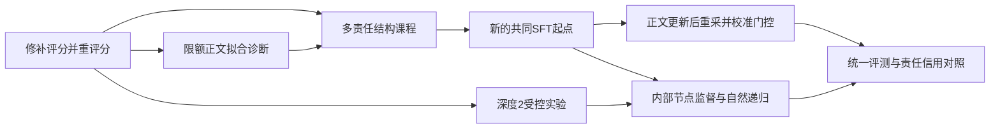

# 规划器下一阶段推进流程

**最新准备（2026-09-22）：** **多契约执行器SFT及配对验收已准备，模型实验未启动。** 6个成对TRAIN契约×ATOMIC/父聚合/流水线，54目标，保留96旧样本；216步、lr1e-5、各目标8曝光。BEFORE/AFTER各56条，共112条自主固定计划验收，分课程、已监督契约开发、未监督契约开发和10根保持。18个CPU作者程序评分通过，3项静态测试及shell检查通过。仅GPU0/1：单卡训练与基线评估并行，之后双卡AFTER；带216步/28条分片进度条。用户启动 `bash scripts/run_contract_course.sh`，未运行训练/模型评估。见[设计与启动说明](/home/lc/AuditTrainer/reports/contract_course.md)。

**最新完成（2026-09-22）：** **12条件固定产物职责诊断完成。** 库存状态仅替换prepare即可恢复原根；单覆盖/多项式符号仅替换aggregate即可恢复compute与根，可见/私有结论一致。单覆盖缺根使用同一人工包装，只算功能重建；另两条原根不变。单覆盖/多项式prepare原已正确，替换为无变化。0模型调用/更新，无评分错误，原成绩/产物/模型保持。

**当前建议：结束局部可修复性诊断，准备多契约执行履约SFT，暂不训门控。** 从root_retention复制、冻结transfer_gate/根门控/BODY；用独立TRAIN成组契约学习库存准备与区间/多项式聚合，同时覆盖ATOMIC完整compute和分解父聚合，保持旧成功能力。自主验收局部/根与旧任务保持后再重采A/S，另留未监督契约确认，不将人工恢复计模型分数。本次仅分析已有结果，未启动新实验。见[分析报告](/home/lc/AuditTrainer/reports/cross_repair.md)。

**最新准备（2026-09-22）：** **三样本×四条件的固定产物职责隔离诊断已准备，尚未运行评分。** 选择stock_status/S0、coverage_single/S0、polynomial_signs/S1，共12条件：原始、只prepare、只aggregate、联合替换。保留其余代码/契约/测试，单覆盖缺根的四条件共用同一包装，单独标为功能重建；无模型调用或训练。4项静态测试、shell语法检查通过；提供3个CPU进程与12条件进度条，GPU无需使用。用户启动命令：`bash scripts/run_cross_repair.sh`。原产物不改写，本轮未评分、未生成实验结果。见[设计与启动说明](/home/lc/AuditTrainer/reports/cross_repair.md)。

**最新完成（2026-09-22）：** **八状态96条跨契约冻结诊断完成。** A5/32、S9/32、自然9/32，自然相对A4胜0负28平，token增加41.3%，较S省9.1%；自然首次S23/32。路径小于阈值A1/4→S/自然4/4；路径等于阈值均4/4；多项式求和A0/4→S/自然1/4；其余五任务均0。已有集中于路径的跨契约正收益与自然调用证据，未形成广泛可靠迁移。96条无编排/评分错误，32组三臂配对一致，模型冻结。代表失败包含prepare/aggregate算法与数据结构错误，不只门控；UNCONFIRMED含一个已注册流水线的标点匹配差异。

**当前建议：保留候选，先小规模固定产物职责诊断，再做独立TRAIN多契约执行履约课程；不继续主要训练门控。** 三类代表轨迹×原始/只prepare/只aggregate/联合四条件，12个离线程序诊断，人工结果与自主成绩分开。已用开发不冒充泛化，后续留新任务确认。按用户要求停在建议，未启动新实验。见[完整分析](/home/lc/AuditTrainer/reports/cross_state.md)。

**最新准备（2026-09-22）：** **八状态冻结跨契约验证已准备，模型实验未启动。** 四个已知算法族各两个新聚合契约，A/新采样S/当前自然门控各4种子，共96条，0训练。transfer_gate/root_retention/根门控/BODY冻结；输入沿用边界模板变换，不称未见算法或独立输入分布泛化。19项CPU测试、8个参考程序评分和shell语法检查通过。已提供2进程自动预约GPU 0/1的并行脚本，用户自行运行：`bash scripts/run_cross_state_parallel.sh`。本轮没有训练命令。见[设计与启动说明](/home/lc/AuditTrainer/reports/cross_state.md)。

**最新完成（2026-09-21）：** **独立内部门控自然执行验收完成。** 读取用户运行的全部分片并离线汇总，未启动新实验。根成功8/16→11/16，4胜1负11平：路径1/4→4/4、多项式2/4→3/4、覆盖保持4/4、库存1/4→0/4。首次SPLIT8→12，平均token增加8.36%。四条新增成功均来自正收益任务改选S；库存两臂同选S，父生成前token预算相差1后执行分歧，不归为门控选择退步。多项式剩余失败两臂均首次S格式拒绝→重试A。32条无编排/评分错误，16组初始观察与根计划一致，正文/执行器/根门控冻结。

**当前建议：保留transfer_gate候选，停止已知状态加训，转冻结模型的跨状态诊断。** 约8新状态×A/S/自然×4种子＝96条，预先定任务与责任结构覆盖；先查新状态分解收益，再查自然调用。按用户要求，新实验需先核对设计与配置、给启动命令后由用户运行。见[完整分析](/home/lc/AuditTrainer/reports/transfer_gate.md)。

**最新准备（2026-09-21）：** **内部门控校准设计与启动配置已准备，实验尚未运行。** 按用户要求停在启动前：从当前internal_gate复制，冻结root_retention执行器/根门控/BODY；路径、多项式按新平均收益提高调用，库存和重复覆盖保持原概率。固定32步、lr1e-5、四状态等权128曝光；随后新旧门控各16条自然执行。7项CPU测试通过，源结果/状态/适配器哈希检查通过，未加载模型、未创建training/natural产物。用户自行启动，详见[设计与命令](/home/lc/AuditTrainer/reports/transfer_gate.md)。

**最新执行更新（2026-09-20）：** **修复执行器后的32条内部A/S价值重估完成。** root_retention执行器、根/内部门控、BODY冻结。路径A0/4、S4/4；库存均0/4；重复覆盖均4/4；多项式A0/4、S4/4。合计A4/16、S12/16，8胜0负8平，S平均token增加47.1%。S首次15份注册（13父聚合、2流水线），1次JSON拒绝后原策略重试ATOMIC成功；无同契约委托。10项测试通过，16组观察/根计划/种子一致，0更新，32条无编排或评分错误。

**当前决定：转独立内部门控有限收益校准及新种子自然配对。** 路径/多项式当前P(S)仅22.3%/29.4%，各有0/4→4/4正方向；冻结执行器/根门控/正文，校准内部调用。重复覆盖持平且S更贵，不强推；库存双零保留执行缺口，不形成强负标签。旧库存正收益不复用，跨轮不同种子不单独归因SFT退步；本轮无自然臂，不称自然收益已改善或未见泛化。见[价值重估报告](/home/lc/AuditTrainer/reports/transfer_refresh.md)、[完整结果](/home/lc/AuditTrainer/runs/refinement/transfer_refresh/result.json)。

以下保留历史记录。

**此前执行更新（2026-09-19）：** **根返回契约保持修复完成。** 从 transfer_sft 复制执行器，8 条既有 TRAIN 根目标一致改名别名，保留全部88条监督；44步，目标各11次、保持各1次。新增24条配对执行：新契约课程4/4→4/4、已用开发4/4→4/4、旧任务15/16→16/16，合计23/24→24/24，1胜0负23平。加权路径原失败种子恢复为正确调用compute并序列化，另一种子保持；其余旧任务无退步。2项测试通过，24组首次观察一致，重载差0，原模型/缓存保持，无编排/评分错误。

**当前决定：局部保持修复通过，转新执行器下A/新采样S价值重估。** 将root_retention最终适配器作为下一轮冻结执行器候选，保持根/内部门控和BODY；在既有四个新契约内部状态各A/S×4种子，共32条新执行。包含全部拒绝、重试、失败和成本，使用平均收益决定是否校准门控。旧库存等估值需重采；本轮固定计划全通过不等于当前BODY分解价值，亦不称未见泛化。见[保持修复报告](/home/lc/AuditTrainer/reports/root_retention.md)、[完整结果](/home/lc/AuditTrainer/runs/refinement/root_retention/result.json)。

以下保留历史记录。

**此前执行更新（2026-09-19）：** **新契约执行履约 SFT 与 48 条自主配对验收完成。** 56 步，14 条目标各曝光 8 次，目标/保持各 112 次。课程根 0/4→4/4，已用开发根 0/4→4/4，旧任务 16/16→15/16；合计 16/24→23/24，8 胜1负15平。新契约 prepare/compute 局部及根调用均8/8。唯一退步为加权路径根将已聚合 queries 误作 distances 再聚合，引发 KeyError；原始失败完整保留。3项测试通过，24组观察一致，重载差0，原适配器冻结，无编排/评分错误。

**当前决定：新契约学习成功，保留候选；先修复根消费返回契约的保持缺口，再重估A/S。** 未达到预设的各旧任务不退步条件，暂不替换 complex_fit、不训门控。下一步有限保持修复与配对复验，保护新契约收益；通过后用新执行器同时重采A与当前BODY新S，旧库存价值需重估。本轮不是未见契约泛化。见[实验报告](/home/lc/AuditTrainer/reports/transfer_sft.md)、[完整结果](/home/lc/AuditTrainer/runs/refinement/transfer_sft/result.json)。

以下保留历史记录。

日期：2026-09-17。依据：所引用的完整对话，以及仓库实验报告、配置、训练日志和实现。下文保留执行前方案，实际完成情况及据此调整的顺序如下。

**最新执行更新（2026-09-19）：** **新契约固定轨迹履约修正完成。** 纳入重复覆盖、多项式全部8条失败SPLIT，24个程序条件；重复覆盖仅修聚合：prepare保持4/4，compute与根0/4→4/4。多项式单修准备或聚合均根0/4，联合修正后局部与根均4/4。已有根源码不变4条全部恢复；另4条缺少根代码，用各条件相同的根包装验证功能恢复，不算自主交接。12项测试通过，0模型调用/更新，无评分基础设施错误，原轨迹/成绩/模型保持。 详见[新契约因果修正报告](/home/lc/AuditTrainer/reports/transfer_repair.md)。

**当前顺序：独立TRAIN新契约执行履约SFT正对照 → 固定计划自主执行与保持验收 → 新执行器下重估A/S → 独立门控收益校准。** 冻结根门控、内部门控与MULTI_BODY；从complex_fit出发，强化多契约语境中的准备与保留聚合，避免只重复旧契约。已有根源码不变的恢复证明内部职责修正有效；补包装的四条仍需模型自主组合验收。人工结果与模型成绩分开，库存收益证据保留。以下保留历史记录。

**此前执行更新（2026-09-18）：** **冻结内部门控的新契约48条A/S/自然诊断完成。** 路径4/4、4/4、4/4；库存0/4、3/4、0/4；重复覆盖与多项式联合求值均0/4。合计A4/16、S7/16、自然4/16。库存有新分解收益，但P(SPLIT)仅29.4%，四次自然均ATOMIC；四次自然SPLIT全落在另外两个双失败状态。自然平均token相对A增加12.2%，本轮未提高根成功。20份S均完整parent_aggregate分配、无同契约委托；四套适配器冻结，0更新，17项测试通过，16组三条件观察/根计划/种子一致，48条无基础设施或评分错误。 详见[新契约迁移报告](/home/lc/AuditTrainer/reports/internal_transfer.md)。

**当前顺序：新契约固定轨迹最小履约修正 → 独立TRAIN执行履约对照 → 新执行器下重估A/S → 扩充独立门控收益覆盖。** 库存已提供新正收益但未充分调用；重复覆盖/多项式双失败缺少有效方向信号，先确认修正准备/聚合职责能恢复根成功，人工结果不计模型成绩。保留分离式架构与库存证据，不增加门控RL预算；本轮状态归开发诊断，后续另留新状态确认。以下保留历史记录。

**此前执行更新（2026-09-18）：独立内部门控收益校准与32条自然配对完成。** 32步/128曝光，根成功10/16→15/16，5胜0负11平；覆盖查询0/4→4/4，多项式3/4→4/4，其余保持。正收益状态P(SPLIT)升至99.6%/98.4%，保持状态最大漂移1.8个百分点。SPLIT次数4→9，平均token增加15.5%；所有九份新S均实质责任分配。冻结根门控/正文/执行器，四份正文逐token一致、重载差0，5项测试通过，最终32条无编排或评分错误。详见[内部门控报告](/home/lc/AuditTrainer/reports/internal_gate.md)。

**当前顺序：保留独立内部门控候选 → 冻结模型验证未训练内部状态 → 有跨状态证据后再考虑扩大训练或根/内部联动。** 本轮证明已知内部收益可以被自然调用并改善最终根成功；不称跨任务泛化。下一轮在未用于门控训练的内部状态比较强制A、当前正文新采样S和自然选择，持平/不确定状态不强造标签；暂不扩大RL预算。以下保留历史记录。

**此前执行更新（2026-09-18）：新执行器下复杂内部32条A/S重估完成。** 加权路径 A4/4、S4/4；库存事件 A3/4、S3/4；覆盖查询 A1/4、S4/4；多项式乘积求导 A2/4、S4/4。4项测试通过，16组观察一致，0更新、模型保持。库存S一次启动评分ERROR原样保留，配对原产物复评均通过；不将其当分解负标签。详见[复杂内部价值报告](/home/lc/AuditTrainer/reports/complex_refresh.md)。

**当前顺序：独立内部门控有限收益校准 → 新种子自然执行验收 → 再扩大状态覆盖。** 覆盖查询、多项式乘积求导提供当前策略的正收益信号；正文、根门控与complex_fit执行器冻结；持平和单次差异不强推方向，保持其他状态，库存评分异常不当负回报。保持根分解，内部ATOMIC仅表示停止继续细分；已用开发结果不称未见泛化。以下保留历史记录。

**此前执行更新（2026-09-18）：完整算法112步正对照完成。** 每目标8次曝光，新增24条自主执行，复用两组历史配对。课程根0/8→8/8，已用同类开发0/8→8/8，保持8/8→8/8；相对32步为14胜0负10平。4项测试通过，24组首次实现观察一致，新增执行无基础设施错误。详见[充分曝光报告](/home/lc/AuditTrainer/reports/complex_fit.md)。

**当前顺序：将112步complex_fit作为下一轮价值估计的冻结执行器候选，保留compute_sft及32步complex_sft作对照。结束当前课程可学习性诊断，下一步重估ATOMIC与当前正文新采样SPLIT的平均执行价值。** 在4个复杂compute状态保留既定根分解，内部ATOMIC与冻结MULTI_BODY新采样SPLIT各4个种子，共32条；两种模式使用同一新执行器，纳入拒绝、重试、失败与成本，再决定是否有理由训练内部门控。不得直接用本轮固定作者计划成绩作门控正标签。以下保留历史记录。

**此前执行更新（2026-09-18）：多结构执行器SFT及48条配对验收完成。** 28条新目标＋46条保持，32步；课程0/8→2/8，已用开发0/8→0/8，保持8/8→8/8，2胜0负22平。12项测试通过、24组首实现观察一致，最终执行无基础设施错误。详见[课程报告](/home/lc/AuditTrainer/reports/complex_sft.md)。

**当前顺序：保留原compute_sft → 完整算法/父聚合充分曝光正对照 → 稳定课程自主执行并复验开发 → 再重采A/新SPLIT价值。** 新分支不替换当前执行器，不训门控；本轮每目标仅2–3次曝光，局部进展未转为开发根成功。同算法/契约已被监督，不称未见泛化；本轮开发副本已明确归TRAIN开发范围，原轨迹、测试与反例不入训。以下保留历史记录。

**此前执行更新（2026-09-18）：复杂任务新旧执行器16条同计划对照完成。** handoff_sft与compute_sft两组根、prepare/compute局部均0/8；0胜0负8平。8组计划及首次实现观察一致，路径反例预先纳入双方，0更新、0基础设施错误，2项测试通过。详见[执行器能力对照](/home/lc/AuditTrainer/reports/complex_executor.md)。

**当前顺序：保留新执行器 → 独立多结构TRAIN课程学习完整算法/输入结构/保留职责并保持既有交接 → 自主局部与根验收 → 重采A/新SPLIT价值 → 再决定门控训练。** 近期SFT之前已有这些具体缺口，本轮不支持回退；零成功不能证明不存在任何训练退步，也不产生负分解标签。开发任务与边序反例保留作验收，不直接入训。以下保留历史记录。

**此前执行更新（2026-09-18）：新复杂内部任务32条冻结对照完成。** 4类预选结构，原始A0/16、S1/16；唯一路径成功程序被边序反例否定，全部8份路径产物追加同一检查后均失败，原分数保留。15份S是真实责任分配、1份首次JSON拒绝。0更新、0基础设施错误，10项定向＋1反例测试通过。详见[复杂内部任务诊断](/home/lc/AuditTrainer/reports/complex_values.md)。

**当前顺序：新旧执行器在4个新任务固定同计划×2种子（16条）对照 → 确认是否存在近期SFT泛化退步或共同能力缺口 → 必要时多结构执行履约课程 → 重采平均A/S价值后再推进门控。** 暂不能断言SFT损伤泛化，也不能将双零作负分解标签；一次通过有限用例不能作为可靠正收益。新任务同时改变算法与输入结构，已成为开发集。简单任务原先的可靠执行进展仍保留。以下保留历史记录。

**此前执行更新（2026-09-18）：新compute执行器32条当前策略估值完成。** 四状态ATOMIC与新SPLIT均4/4；16份S全为不同责任分配，局部、真实父调用、根成功32/32。0更新、0协议拒绝、0基础设施错误，5项测试通过。S较A计费token增加54.7%—105.4%。详见[当前内部价值重估](/home/lc/AuditTrainer/reports/compute_refresh.md)。

**当前顺序：保留新执行器及根分解 → 预先选择更复杂责任依赖的内部任务，冻结策略采A/新SPLIT平均根收益 → 有分解正负收益差异后训练独立内部门控。** 四个简单compute已均可直接完成，停止重复履约修复；成功目标持平，成本目标可支持内部停止，但本轮没有更新门控。内部ATOMIC不等于根ATOMIC。旧失败价值不再代表当前策略，其他根价值仍需按后续任务重估。以下保留历史记录。

**此前执行更新（2026-09-18）：内部compute执行器SFT自主验收完成。** 4个独立TRAIN参数6/新输入变体，10条目标＋36条保持，32步后48条配对：FIT2/8→8/8、开发2/8→8/8、保持8/8→8/8，12胜0负12平。计划逐对一致，新模型compute局部与根调用16/16，24条无协议拒绝；门控/正文/旧执行器保持，5项测试通过，重载差0。详见[执行器履约SFT](/home/lc/AuditTrainer/reports/compute_sft.md)。

**当前顺序：采用新执行器候选 → 4个内部compute状态各ATOMIC/当前新采样SPLIT×4种子，32条价值重估 → 有正负收益证据后再训练独立内部门控。** 本轮固定计划执行改善不等于分解比直接实现有收益；正文和门控继续冻结，旧执行器价值不能复用。开发状态已参与此前诊断，不能称为新家族泛化。GPU3中断记录及同种子重跑保留，最终48条完整。以下保留历史记录。

**此前执行更新（2026-09-18）：固定计划执行因果诊断完成。** 上一轮全部11条失败SPLIT逐条仅修一个内部模块：7条保留原根代码，局部与根0/7→7/7；4条原无根代码，在相同人工包装下0/4→4/4。修正后全部局部及根可见/私有测试通过；22份程序检查、0模型调用、0更新。详见[履约因果诊断](/home/lc/AuditTrainer/reports/compute_repair.md)。

**当前顺序：独立TRAIN变体的小规模执行器SFT → 自主实现/交接/根生成与既有能力保持 → 重采内部ATOMIC/新SPLIT收益 → 再决定内部门控训练。** 监督目标为聚合对prepared语义的履行、最终输出字段、当前函数与根的序列化边界。保留当前执行器对照，冻结门控及正文。人工修正仅证明可恢复，缺根组不算自主恢复；不把11/11替换原SPLIT模型成绩或据此生成正门控标签。以下保留历史记录。

**此前执行更新（2026-09-18）：不同责任的内部compute对照32条完成。** 4个既有TRAIN状态各A/S×4，calendar、intervals均0/4对0/4，chunks为4/4对2/4，words为4/4对3/4；16份新SPLIT全为不同责任分配，无同契约委托。0更新、0基础设施错误，4项测试通过。详见[内部compute价值诊断](/home/lc/AuditTrainer/reports/compute_values.md)。

**当前顺序：固定计划修正aggregate/compute具体履约缺口，确认根恢复 → 依据因果结果决定执行器学习 → 新执行器下重采A/S价值 → 有正负收益依据后训练内部门控。** 本批未发现正分解收益，不能直接扩门控训练；双零不形成强停止标签，words单条差异保留不确定。已定位未定义调用、缺少最终输出字段、提前序列化；未出现此前越级消费绑定问题。四状态曾用于正文SFT，本轮不宣称未见泛化。以下保留历史记录。

**此前执行更新（2026-09-18）：新执行器32条内部/根价值重估完成。** 两个内部prepare均A4/4、S4/4，8份S均同契约委托，token额外26.9%/39.5%；两个相关根均A0/4、当前新采样S4/4，内部策略自然不变。0更新、0基础设施错误、0协议拒绝，模型指纹保持，3项测试通过。详见 [当前策略重估](/home/lc/AuditTrainer/reports/post_handoff_values.md)。

**当前顺序：保留根分解与两个prepare停止偏好 → 在确有不同责任可分的内部compute状态采ATOMIC/新SPLIT平均根收益 → 有正负收益依据后再训练独立内部门控。** 旧内部0/8价值标签失效，但当前成功率持平不能改写为SPLIT失败；减少无收益委托应明确成本或停止监督。本轮只重估两个开发根，其他旧执行器根价值尚未刷新。以下保留历史记录。

**此前执行更新（2026-09-18）：递归交接执行器SFT完成并通过自主验收。** 独立TRAIN模11变体12条目标＋24条保持，32步训练后：固定失败前缀0/8→8/8、完整固定嵌套计划0/8→8/8、原子/浅层保持6/8→8/8；18胜0负6平。原提示、模型自主消费和写代码，无人工修正、无协议放宽。根门控/正文/旧执行器不变，重载差0，43条新执行＋5条缓存，6项测试通过。详见 [交接SFT](/home/lc/AuditTrainer/reports/handoff_sft.md)。

**当前顺序：保留新执行器候选＋既有分离规划器 → 新执行器下重采同一内部状态的ATOMIC/当前新采样SPLIT价值 → 重估受影响的根价值 → 有差异化收益证据后训练内部停止/分解。** 旧分解0/8不能继续当永久标签；本轮证明递归执行恢复，不证明同契约单子委托比直接实现更好，也不能用固定作者计划替代当前正文策略的平均收益。两个同家族新TRAIN变体与旧开发状态不构成新家族泛化。以下保留历史记录。

**此前执行更新（2026-09-18）：完整直属产物绑定因果修正＋模型自主对照完成。** 合格产物5条仅修消费绑定，正确消费5/5、根3/5；另外3条缺失产物路径经当前函数实现＋绑定双修正，根3/3。自主原输入/摘要输入均0/5消费、0/5根成功，人工结果不计模型成绩；18条无基础设施错误、参数冻结、既有合格代码不变。详见 [交接报告](/home/lc/AuditTrainer/reports/handoff.md)。

**当前顺序：保持根分解和两个prepare内部停止 → 独立TRAIN嵌套状态的小规模执行器SFT，学习完整直属产物绑定及当前函数接口/职责 → 自主交接、根成功、原子执行保持对照 → 重估内部与根收益后再训练内部规划。** 人工修正证明交接阻断可解除，但后续aggregate仍可能失败；摘要提示本轮无效，不并入默认提示。无需放宽宿主协议，不能把同契约委托恢复可执行等同于有价值的责任细化。以下保留历史记录。

**此前执行更新（2026-09-18）：固定内部状态16条冻结对照完成。** 多项式模5与路径模7的prepare，ATOMIC根成功各4/4、SPLIT各0/4。多项式SPLIT局部4/4通过，根却全部误消费孙节点；路径SPLIT仅1/4产生局部通过产物，伴随当前函数接口/职责混淆。16次内部计划均注册，模型冻结，完整观察逐次一致，0基础设施错误。详见 [内部状态对照](/home/lc/AuditTrainer/reports/internal_probe.md)。

**当前顺序：保留根门控和正文 → 固定递归计划下最小修正消费直属子节点，确认根恢复 → 对路径当前接口/职责补齐做执行对照 → 执行交接改善后重估内部ATOMIC/SPLIT与受影响根价值 → 再训练内部停止/分解。** 两个状态已提供停止细分的负收益证据，但不把当前执行缺陷直接推广成递归无用。路径模7现为已用开发诊断状态。以下保留历史推进记录。

**此前执行更新（2026-09-18）：当前策略重新估值、独立根门控校准和自然调用验证完成。** 128条新执行器估值后，固定32步校准；自然TRAIN成功18/32→22/32，两个未训练同家族参数变体3/8→7/8，9胜1负30平。路径训练0/4→4/4、路径模7变体0/4→3/4，多项式模7变体3/4→4/4，均出现真实分解调用。多项式训练3/4→3/4，包含一次误消费孙节点的退步。正文/执行器冻结，4组正文逐token一致，重载差0，208条执行无基础设施错误。详见 [门控重估报告](/home/lc/AuditTrainer/reports/gate_refresh.md)。

**当前顺序：保留新根门控＋冻结MULTI_BODY＋新执行器 → 少量固定内部状态的ATOMIC/SPLIT对照 → 依据最终根成功训练内部停止/分解或修复职责履约 → 重新估计受内部策略变化影响的根价值。** 剩余明确失败为内部prepare写成compute并提前聚合、父节点错误消费孙节点。本轮支持同家族参数迁移，TRANSFER曾用于上一轮执行器开发评估，不将其包装成新组合家族泛化。以下保留各阶段历史推进记录。

**此前执行更新（2026-09-18）：小规模执行器SFT及当前策略重估完成。** 一次32步F01副本SFT后，固定计划根成功：两个训练状态0/8→8/8，未训练模7/新输入变体0/8→8/8，原始两类契约4/4→4/4。随后新采样对照：多项式ATOMIC1/4、SPLIT3/4；路径ATOMIC0/4、SPLIT4/4，旧F01四组均0/4。8份配对根正文逐token一致，门控/正文不变，旧F01保留。72条模型执行无基础设施错误，重载差0。详见 [执行器SFT报告](/home/lc/AuditTrainer/reports/executor_sft.md)。

**当前顺序：保留新执行器候选与旧F01对照 → 在新执行器下重采既有正负TRAIN状态收益，并纳入本轮两个正收益状态 → 校准独立根门控 → 自然调用验证 → 再推进内部节点。** 两个当前根SPLIT概率仍接近0，尚未学习更新后的执行价值；不得沿用旧F01的六任务估值。完整计划履约修复已成功，不重开单例学习或盲目增加执行器训练预算。当前SPLIT唯一失败为根消费错误引用孙节点，已计入均值；递归执行仍有这个明确缺口。

**此前执行更新：固定计划的执行履约修复诊断完成。** 两份旧失败产物仅修正子返回值，父代码不变，局部与根测试全部恢复通过。两个新TRAIN变体的16条模型对照中，原输入和当前prepare最终输出澄清的局部私有/根成功均为0/8；模型参数冻结，无基础设施错误。多项式澄清后仍漏次数排序，路径仍产生嵌套长度列表。父节点16/16实际消费调用，聚合代码正确。详见 [执行履约报告](/home/lc/AuditTrainer/reports/execution_repair.md)。

**当前下一步：小规模执行器SFT，保留旧F01对照 → 检查完整局部履约与最终根成功 → 同时重采ATOMIC和当前MULTI_BODY新SPLIT平均价值 → 有新分解正收益后再扩门控 → 最后内部节点。** SFT重点是当前契约的最终转换及保留义务，包含排序、去零和空路径计数；不把输出类型正确替代完整正确。执行器改变后旧价值不再复用。本轮已完成用户限定的人工修正确认＋16条对照，尚未启动SFT。

**此前执行更新：新任务96条冻结诊断全部完成。** 8个未用组件配对覆盖4类接口组合，强制ATOMIC 12/32、新采样SPLIT 5/32、自然执行12/32；自然32次均ATOMIC。32份SPLIT全部注册并匹配完整责任分配，0基础设施错误、0参数更新。三个任务直接实现更好，其余五个均未成功，本批没有可供扩训的新正收益分解状态。详见 [新任务报告](/home/lc/AuditTrainer/reports/fresh_gate.md)。

**当前顺序调整为：保留分离门控与冻结正文 → 在独立TRAIN场景改善新组合契约的执行履约 → 重新采样比较当前ATOMIC/SPLIT平均收益 → 有新正收益证据后再扩门控覆盖 → 最后内部停止/分解。** 具体先解决prepare遗漏系数提取/路径长度转换、父聚合遗漏筛选、字符前缀实现错误。正文完整生成已经推广，不重开单例学习；本批0对0的任务不强造门控标签，不扩大RL预算。改变执行器或内部策略后重采估值；这8任务已成为开发集，最终确认另留新任务。

上一轮VALIDATION的两次SPLIT都在calendar→intervals且均失败，四条净增成功来自其他任务转ATOMIC；本轮仍未证明发现新的分解收益。以下保留此前完成顺序与证据。

**此前执行更新：独立根门控的差异化正对照通过，六任务收益校准和自然执行完成。** 两任务等量门控SFT 80步后，calendar的SPLIT概率由20.18%升至约100%，intervals由20.18%降至接近0%；继续48步六任务收益校准，五个非零收益状态相对原模型的方向均正确。正文、内部节点策略和F01始终冻结，两阶段16次配对生成逐token一致，重载差0。自然成功率TRAIN 15/24→18/24、VALIDATION 16/24→20/24，合计7胜0负41平；TRAIN分解总次数仍为4次，但转移到了正收益calendar，其成功由1/4→3/4。详见 [分离式门控报告](/home/lc/AuditTrainer/reports/separate_gate.md)。

**当前推进起点：独立根门控＋冻结原MULTI_BODY正文与内部策略。** 本轮已验证方向学习和正文保护，无须重开单例正文诊断。接下去扩大具有正负收益对照的任务覆盖，继续用自然执行与逐任务调用检验效果；内部门控仍保持冻结，待根门控覆盖扩大后再单独推进。两任务拟合不等于泛化，当前VALIDATION仍是已有开发集；本轮未单独比较SFT与收益更新的自然效果，不将整体收益归因于某一训练阶段。

**此前执行更新：接口对照、当前正文重新估值、门控校准全部完成。** 原输入8/8、澄清输入4/8，继续原输入；144条新估值确认1个TRAIN根分解更好、4个直接更好、1个持平。48步校准后自然执行TRAIN由15/24升至16/24、VALIDATION由16/24升至20/24，但48条均ATOMIC，正收益calendar的SPLIT概率反而从20.18%降至1.80%。正文回归的未训练组合完整分配匹配由91/96降至76/96，TRAIN目标匹配由82/96降至60/96。详见 [接口与门控报告](/home/lc/AuditTrainer/reports/interface_gate.md)。

**上一轮据此确定方向（正文保护与差异化正对照现已完成）：保留原MULTI_BODY正文起点 → 保护正文能力 → 学习正负收益状态的差异化门控 → 再推进内部调用与执行信用。** 新校准模型仅作保守门控对照；自然总成功率提高不足以替代正收益任务调用和正文保持。正文多任务推广已成立，不重开单例可学习性诊断，也不扩大本轮整体收缩的门控配方。以下保留此前各阶段方案与历史依据。

**此前执行更新：纯正文多任务推广已完成。** 从原共同 SFT 独立训练 24 个 SPLIT 状态，120 步、每状态 20 次曝光；三组共完成 576 条条件计划、36 条自然执行。多任务训练状态完整目标由 7/96 提高到 82/96；12 个未训练组合的完整分配由 29/96 提高到 91/96，其中根为 16/48 → 44/48、内部为 13/48 → 47/48，12 个组合全部改善。自然执行为共同 SFT 9/12、单例正文 11/12、多任务正文 10/12。正文能力的多任务、多结构与内部组合推广已经得到明确支持，结束这一阶段的可学习性诊断。详见 [推广报告](/home/lc/AuditTrainer/reports/body_transfer.md)。

**此前约定顺序（已完成）：有限 TRAIN 接口对照 → 当前正文分布重新估值 → 门控校准。** MULTI_BODY 作为责任正文候选起点，保留 B0 和单例父聚合对照。先沿用下面的 16 条 TRAIN 内部接口澄清预算；本轮自然执行再次出现完整 pipeline 下的聚合返回元组、父节点输出数组而评分期待对象的具体问题。随后在 TRAIN 比较 ATOMIC 与当前 SPLIT 的平均完整执行价值，再优化门控，不能用参考最佳计划的收益代替当前正文分布的均值。门控与停止行为继续单独测量；本轮自然子节点均选 ATOMIC，未证明自然二次细化收益。12 个已使用的组合继续作为开发集，正式确认时另用新组合及独立训练种子。

**执行更新：工作包 0—2 已完成。** 228 个旧产物重评；纯正文目标自由生成由 27/64 提升到 64/64；24 根课程完成 80 步 SFT；48 条深度 2 对照中，内部 ATOMIC / 参考 SPLIT / 自然规划为 13/16、9/16、12/16。intervals 的自然责任分配达到 4/4，而两个固定条件均为 1/4；其他根的损失使总体尚未超过 ATOMIC。详见 [纯正文诊断](/home/lc/AuditTrainer/reports/body_fit.md) 和 [课程及深度 2 报告](/home/lc/AuditTrainer/reports/responsibility_course.md)。

**工作包 3 前加入一次有限的内部接口校准。** 当前明确问题是内部原生结果与根 JSON 文本混淆，以及子输出/下游前置条件、所有者和数据流不一致。两条只去除多余序列化的 CPU 反事实已经通过，但尚未证明提示澄清能让冻结 F01 稳定修正。下一步用 2 个固定内部状态 × 2 种输入条件 × 4 个配对种子，做 16 条组合及祖先续跑；随后补内部主动停止和已出现的字段一致性课程对照，再进入正文—门控闭环。沿用现有契约字段与 runtime，不扩建 schema 或通用验证体系。原 48 条结果和既有基线保持冻结。

**推进主线确定为：可执行责任正文学习 → 按当前正文能力校准门控 → 内部节点复用 → 责任决策的执行信用。** 保留 Qwen3-8B、共同结构 SFT 起点、冻结 F01、父组合摘要和现有 runtime。近期用一次限额诊断结束 calendar 单例循环，同时启动多责任结构课程与受控深度 2 实验。递归研究不再等待旧 B3 先取得稳定优势。

**一、当前证据说明了什么**

| 已核对的事实 | 对推进流程的影响 |
| --- | --- |
| calendar 固定父聚合计划 12/12，ATOMIC 4/12；已有自然轨迹中，首次完整好计划后的通过数为 10/10、12/12、7/7、10/10 | 当前执行器已提供一个明确的规划学习支点；优先解决稳定产出好计划，而非普遍重训执行器。旧数值仍需在补充评分下复核。 |
| calendar 正文 CE 从 0.1972 降至 0.1230，条件好计划却由 16/32 变为 14/32；联合监督为 17/32 | 目前只证明示范前缀上的拟合改善；尚未证明自由生成的责任分配能力改善。 |
| 联合监督将 P(SPLIT) 从 22.27% 提至 29.42%，自然通过从 24/48 变为 22/48 | 提高分解倾向不是验收目标；必须同时测正文质量与最终执行。 |
| 摘要统一后的 B3 相对成功 SFT，四组净增为 +1、0、0、0 | 继续扩大原训练配方缺乏支持；保留它作对照。 |
| 多轮 B3/B4 已做过 5 轮重采；B4 已实现 SPLIT 留一正文优势，自然结果为 B0 29/60、B3 31/60、B4 29/60 | “增加重采”“换成留一基线”均不是未试过的核心改进。下一轮应检验新的能力学习目标与更新顺序。 |
| F3 已用脚本跑通根—子—孙三层；当前路由把所有 NEW 节点交给规划器，只是实验覆盖为 max_depth=1 | 深度 2 的主要缺口是训练状态、契约与局部验证覆盖、内部状态分叉，不是重写递归引擎。 |
| 一条既定测试通过的 calendar 代码，在合法输入上实际错误 | 修补该明确评分盲点是下一轮回报采集的前置条件。 |

证据：[固定计划报告](/home/lc/AuditTrainer/reports/B3_fixed_plan.md:5)、[calendar 正对照](/home/lc/AuditTrainer/reports/B3_calendar_target.md:15)、[摘要统一后的训练](/home/lc/AuditTrainer/reports/B3_summary_training.md:9)、[多轮 B3/B4](/home/lc/AuditTrainer/reports/PR1C_multiround.md:10)、[F3](/home/lc/AuditTrainer/reports/F3.md:28)。

对话中的总体方向成立，但需要三点落地修正。

第一，留一基线直接复用现有 B4 实现。新分支的差别应是：给条件正文明确训练预算，正文更新后重新估值，再更新门控。第二，先用现有契约、owner 映射和数据流做递归试验，不预先增加一批 schema 字段。第三，停止把“每个小种子块都必须严格净胜”当成整个项目的前进门槛；保留历史实验的原判据，新实验区分工程接通、能力学习和算法优势三个层次。

**二、推进顺序与依赖**

| 工作包 | 具体工作 | 依赖与结束条件 |
| --- | --- | --- |
| 0：评分修补 | 修补已确认反例，离线重评分相关程序 | 在新回报采集前完成；通过后结束，不扩展成全面验证器重构。 |
| 1：正文可学习性 | 一次纯正文 SFT 诊断，主要观察强制 SPLIT 后的自由生成 | 使用复核后的目标；固定预算结束，不持续围绕 calendar 调参。 |
| 2A：责任课程 | 构建 24 个 TRAIN 根的结构覆盖，形成新的共同 SFT 起点 | 可与工作包 1 同时准备；训练配置吸收诊断结论。 |
| 2B：深度 2 诊断 | 4 个 TRAIN 根，固定根计划，比较内部 ATOMIC、参考 SPLIT、学习规划 | 与 1、2A 独立准备和执行；不要求旧 B3 先获胜。 |
| 3：正文—门控闭环 | 从新共同起点比较成功 SFT、B3、条件正文后校准门控 | 需要可生成、可执行且有比较信号的计划；先做有限根状态试验。 |
| 4：递归训练与责任信用 | 内部节点监督、自然递归、少量同状态责任干预 | 依赖 2B；可以采用有效的 SFT 起点，不必等待 RL 获胜。 |
| 5：泛化与方法结论 | 新责任组合、独立训练种子、功能与责任指标 | 在方法固定后执行；修复价值与共享执行器回接后置。 |

**三、工作包 0：只修已经确认的评分缺口**

calendar 的已知错误把“逐个 prepared 值是否能被 3 整除”写成了跨步长求和。合法输入 `["00:01","00:02","00:03","00:05"]` 的预期为 `{"indices":[2],"total":3}`，错误程序输出 `{"indices":[0,2],"total":4}`。[反例原件](/home/lc/AuditTrainer/runs/refinement/B3_calendar_target/public_counterexample.json)

把这个反例和少量同类边界输入加入下一轮的离线评分，并覆盖受影响的 root 与相应局部契约。原公开任务和模型可见信息保持同一含义；额外评分答案不进入规划 observation。先用参考实现核对，再用保存的程序做 CPU 重评分。

优先重评 calendar 的 36 条固定计划校准与 192 条正对照自然产物；准备复用的历史训练回报也必须按新评分重算。其他历史产物只在用于当前判断或训练时重评，不进行全仓库无差别重跑。缺少产物的失败继续保留分母。新结果另存，旧报告继续表示原定测试的结果。

结束条件是：已知错误被检出、参考实现通过、下一轮所用目标与回报口径一致。若已知好计划的优势经重评削弱，就按新证据调整目标，不能沿用 12/12 为其背书。

**四、工作包 1：最后做一次限额正文诊断**

当前 calendar 目标正文是 174 个 token。代码对目标 CE 取平均、对正文 KL 按 token 求和，所有训练组还保留 SFT 约束；日志显示参数确实变化。因此，“没更新”“KL 一定压制目标”“全局 1/256 就是有效学习率缩小 256 倍”都不是现有证据可以确认的结论。[训练实现](/home/lc/AuditTrainer/src/audittrainer/refinement_calendar_target.py:95)

新增一个只回答“能否学会该正文”的诊断分支：从共同结构 SFT、空 AdamW 开始，只训练明确好计划的平均正文 CE，去掉门控目标、KL 与保持项。建议固定学习率 1e-5、最多 80 次更新，保留现有 tokenizer、prefix、生成温度、完整 plan 编码。它是有意过拟合的能力检查；同时改变约束与更新强度，不据此单独归因某一超参数，也不直接作为部署检查点。

起点与最终模型各做 64 条新种子的条件 SPLIT 自由生成，使用同一宿主注册与完整分配匹配；先不投入整批自然执行。预先记录四项：注册率、目标责任结构频率、owner/子契约/父职责/数据流的主要错误、固定目标 CE。别名和顺序可规范化；契约内容发生变化时，需要实际契约判断，不能靠字符串近似认定等价。

诊断参考目标是完整目标结构达到约 80%（至少 52/64），用于判断有没有明显的可用能力，不作为统计显著性声明或整个项目的硬门槛。

| 诊断结果 | 下一步 |
| --- | --- |
| 自由生成明显改善 | 采用这条可工作的正文学习路径进入多任务课程；在多任务阶段恢复必要保持约束，并重新校准门控。 |
| CE 明显下降，自由生成仍常出错 | 只处理最高频的当前错误：关键责任字段训练或必要的冗余编码压缩；先不追加大规模执行回报。 |
| CE 本身也不能有效下降 | 检查目标 mask、梯度与真实更新量；只在此处定位训练实现或强度问题。 |

需要梯度诊断时，只分析一个有代表性的更新窗口；无需重跑旧四分支或进行大规模权重扫描。80 步结束即形成判断。课程准备和深度 2 接通不因未达到 52/64 停止，依赖稳定正文的门控优化则推迟到具体问题解决后。

**五、工作包 2A：让训练覆盖不同责任结构**

首轮以 24 个 TRAIN 根为目标，覆盖下列六类决策，每类约 4 个根；这是课程设计规模，不是论文样本量结论。优先复用现有任务构造器、审定计划和 oracle，补缺失结构。新增 root_id、参数值或同一根的多次曝光不能冒充新的语义任务覆盖。

| 责任结构 | 主要学习内容 |
| --- | --- |
| 适合直接实现 | 在仍允许 SPLIT 时选择 ATOMIC；学习主动停止。 |
| 下放预处理、父保留聚合 | 父职责不会因委派而消失。 |
| 下放聚合、父保留预处理 | 数据应满足子接口前置条件，不能直接传原始输入。 |
| 两个子组件串联 | 明确中间值、调用次序和父节点绑定职责。 |
| 多项子责任共同支持上层义务 | 分解不仅是已有责任 ID 的集合分区。 |
| 子职责需要继续细化 | 相同规划决策在非根状态上复用。 |

SFT 的正目标来自实际可执行且有对应责任证据的计划。结构合法不等于收益更高；功能通过而语义责任 UNKNOWN 的样本可以用于功能或协议监督，不能自动标为完整责任正确。对 intervals 这类收益差距很小的候选，保留多种合法方案，不把有限次数中最高分者硬设为唯一最优标签。

计划仍使用现有 `children / obligation_map / retained_responsibilities / dataflow`。父契约已有版本，子契约已有独立 ensures；先在这套表示下明确“上层义务由哪些子保证和父组合职责共同支撑”。只有具体深度 2 样例证明现有表示无法清楚表达该关系时，才补最小的细化关联；不预先重写 schema、renderer 和历史数据。

从共同起点训练一个新的课程 SFT 模型，后续算法统一从它分叉；calendar 过拟合模型不串入主训练链。课程的目标是得到可生成、可执行的责任计划支持，不要求先证明 RL 优于 SFT。

同时固定 12 个用于开发验证的未训练根，按语义任务/责任组合划分，整棵树的子节点和所有续跑随根进入同一划分。已用于研究决策的旧 VALIDATION 集保留为开发参照；正式确认泛化时另外使用尚未据其结果调整方法的组合。已知组件的新组合和未知任务族泛化分开表述。

**六、工作包 2B：现在做深度 2，但先做受控局部递归**

根为深度 0，孙节点为深度 2。第一轮选择 4 个 TRAIN 根：2 个有明确内部细化空间，另 2 个作为停止/过度分解控制。先固定经过验证的根计划，每根开放一个内部节点，其余规划固定；比较内部节点三种条件：规范 ATOMIC、已审查参考 SPLIT、当前学习策略自然选择。

每条件 4 个配对执行种子，合计 **4×3×4=48 条根级完整续跑，零 RL 更新**。参考 SPLIT 提供局部可执行性依据，当前模型即使选择 ATOMIC 也如实记录；宿主在深度上限强制 ATOMIC 不算学会停止。

复用当前 max_nodes=7 与公共根调用/token/验证上限，所有条件使用相同预算；继续关闭功能修复。使用现有冻结父组合摘要，先确认它在内部 COMPOSE 的实际输入中也正确生效。某个结构在当前预算内根本不可行时，应作为诊断结果处理，不单独给该方法增加预算。

关注的是孙产物验证、子节点明确消费与组合、根节点继续消费并完成任务这条链。`called=true` 只证明发生调用，不证明结果被使用；少量目标案例需要检查返回值使用及父节点是否重新实现已委派职责。

运行时与 NEW 路由已具备：[RefinementRouter](/home/lc/AuditTrainer/src/audittrainer/refinement_policy.py:275)。已有父组合重放也能复用部分恢复逻辑，但其恢复点限定为深度 1 的父 IMPLEMENT，不能直接视作任意内部 NEW 快照分叉已完成：[restore_parent](/home/lc/AuditTrainer/src/audittrainer/refinement_parent_composition.py:85)。第一轮固定根诊断可从根重放，只在后续需要内部候选比较时补该恢复能力。

本包的通过条件是受控递归和证据链可正确执行，不是 4 个任务都必须因增加深度获益。若参考二次细化在某类任务不如直接实现，保留该类的停止监督；若存在重复的内部细化收益，就优先将对应内部状态加入课程。

**七、工作包 3：比较一个明确改变训练顺序的新方法**

待课程提供有效计划支持后，保留冻结课程 SFT 作为参考，并训练三条分支：执行验证后的成功计划 SFT、现有 B3、条件正文更新后校准门控。三者从相同新起点与空 Adam 开始，F01、摘要、奖励口径、任务和每次执行预算相同。

新方法每周期执行以下过程：

1. 从本轮固定策略采样同状态候选，取得完整执行反馈。
2. 只施加条件正文的策略改进目标，做 4 次更新。
3. 用更新后的策略重新采样正文、估计当前 SPLIT 平均价值与 ATOMIC 价值。
4. 只施加门控价值目标，做 2 次更新；然后进入下一周期。

正文优势直接复用现有留一形式：

\[
A_j^{body}=\hat Q_j-\frac{1}{K-1}\sum_{\ell\ne j}\hat Q_\ell.
\]

本阶段给条件正文独立训练预算，正文策略项不再乘当前的低分解概率 p(SPLIT)，即以 1/K 而不是 p/K 权重优化条件能力。这是有意改变的训练目标，不宣称仍是原自然策略目标的原样无偏梯度。该改变与短周期重新估值组成待检验方案；不能把收益全部归因于留一基线。

门控使用新采样的平均值：

\[
\Delta_g=\hat Q_S(q_{new})-\hat Q_A,
\qquad
L_g=-[(1-p_\theta)\operatorname{sg}(\hat Q_A)+p_\theta\operatorname{sg}(\hat Q_S)]+\beta_g KL_g.
\]

Q_S 包含当前条件策略采到的无效和低质量计划，不使用最优人工计划或 max Q 替代平均能力。奖励继续保留完整后续回报；另行统计首次注册成功与重试恢复，不重启“初始拒绝全部归零”的主线。

**首轮限额：6 个代表 TRAIN 根、2 个周期、每周期两次反馈采集。** 每次每根 1 个 ATOMIC、4 个 SPLIT，每候选 3 次续跑，另 3 次独立自然基线，共 18 条。每训练分支为 6×2×2×18=432 条续跑、12 次更新；三条分支最多 1,296 条训练续跑。这是完成前述能力工作后才投入的比较预算，不属于立即启动的工作。

成功 SFT 和 B3 使用相同采集时点与 4+2 更新次数，分别持续使用自己的原目标；后续采样跟随各自策略。自然基线即使某分支不用也单列为预算开销。候选重复与失败保留，行为概率随每次采集更新，KL 参考固定为共同起点，优化器在同一分支内正常连续继承。实际 tokens、调用和训练曝光另报；等续跑数不等于严格等算力。

现有 B4 的留一实现已经可用：[two_level_advantages](/home/lc/AuditTrainer/src/audittrainer/refinement_policy.py:102)、[credit_terms](/home/lc/AuditTrainer/src/audittrainer/refinement_pr1.py:64)。继续共享规划 LoRA，交替的是损失，不是另一种能力的参数冻结。正文阶段记录门控变化，门控阶段记录正文变化；只有反复观察到实质干扰，才增加双适配器隔离对照。

本包主要观察强制 SPLIT 的有效责任计划率与平均执行价值、自然根成功率以及相对两个训练对照的收益。小样本持平时保留更简单的 SFT 路径，递归课程继续推进；不要求先证明 RL 必需。出现清晰改进后再做多训练种子确认，届时才为算法优势作强结论。

**八、工作包 4：把能力推广到内部节点，再检验责任信用**

先训练节点级 SFT，再做多节点 RL。内部节点样本使用实际收到的契约、可用接口、版本、剩余预算和原始可见状态；复用运行时 observation，不能简单把根任务文本改个 node_id。来自固定参考树的课程与来自学习策略自然树的状态分别记录，逐步补充后者。

能力隔离按以下顺序进行：固定根、学习内部规划 → 学习根、参考内部规划 → 根和内部节点共享学习规划器。参考子计划只能用于契约匹配的状态。前两组解释瓶颈，最后一组评价自然递归。

内部节点价值仍是固定后续规划快照与 F01 下的根任务最终回报：

\[
Q_u(a)=\mathbb E[R_{root}\mid s_u,a,\pi_{continuation},F01].
\]

第一版用完整回报训练各个真实规划决策，作为多节点基线；无须新建 critic。然后只选少量内部状态，对一个责任转移操作做对照：同步改变责任归属及必需的契约/数据流，冻结无关分支，重跑受影响子树与祖先组合。局部 PASS 提供履约证据，不能取代根级价值。

恢复内部状态时只复制决策前已有产物、依赖、验证证据、递归栈和已消耗预算；未来代码不进入分支。候选比较使用显式后续执行种子。若后续只采部分内部状态训练，说明它是课程加权目标，或按其纳入概率校正，不能宣称未经校正的全轨迹无偏估计。

责任监督绑定到具体计划与产物版本：首次无效计划后来靠重试成功，可以得到系统恢复回报，但不能因此变成责任正确示范。UNKNOWN 保持未知。先对少量案例建立可复核的责任转移收益证据，再判断是否值得推广为训练方法，不一开始为所有 token 构造所谓因果奖励。

**九、评测与停止规则**

| 要回答的问题 | 主要证据 |
| --- | --- |
| 正文能否学会 | 条件自由生成的完整责任结构与注册率；CE 只作诊断。 |
| 能力能否改善任务完成 | 自然单次规划、原有协议重试预算下的根成功率；首次有效计划与恢复收益分列。 |
| 是否保持责任 | 审计范围内的履约、越界、消费与父组合证据；同时报告确认违规、UNKNOWN 和覆盖率。 |
| 递归是否有价值 | 同预算 D=0/1/2 对照，内部停止行为与根完成率；深度和节点数仅作描述。 |
| 新训练法是否优于简单方法 | 同起点、同反馈预算的成功 SFT、B3 与新方法；有效结果再用独立训练种子确认。 |
| 是否泛化 | 以根/任务族为单位汇总未见任务和责任组合；相关续跑不能充当独立任务样本。 |

开发期以根为单位报告均值、配对胜负和不确定性，不以零散一两条净胜宣布方法成立，也不要求所有种子块无一例外获胜。正式方法判断关注多任务、独立训练种子上的一致总体改善及收益来源。相同自然轨迹初始种子不保证后续执行随机状态相同；需要隔离计划效应时，使用决策后重置执行种子的固定计划对照。

保留当前成本权重为零来先研究能力，但始终报告实际成本与固定预算成功率。已知 calendar 父聚合平均执行 token 约为 ATOMIC 的 5.73 倍，现阶段目标是完成率提升，不能写成效率提升。成本优化待能力结果可复现后再作为一个单独问题。

评分错误、状态恢复不一致、训练输入泄漏和无有效更新是阻塞项。某个小任务未获益、某个种子块持平、UNKNOWN 未完全消除，不是暂停全部路线的理由。诊断按固定预算收束；简单 SFT 若已有效，就用它继续递归研究，不为证明 RL 必需而无限增加分支。

**十、研究定位与近期交付**

主张应围绕“契约保持的递归责任细化”：模型把上层义务变成可验证、可组合的子责任，并学习何时细化、何时停止，以及哪些责任边界真正改善最终执行。需要的关键证据是功能正确之外的责任遵守、跨层组合和有针对性的责任决策收益。

这一路线与相关论文的联系已经核对：Plan-and-Act 用执行轨迹构造可行规划监督，可支持课程构造；CoRe-Code 在冻结 Coder 时通过下游执行反馈训练 Planner，表明规划—执行分离本身不足以作为独有贡献；HiPER 显式区分切换、子目标与执行层并构造层级信用，支持按决策层次组织比较，但其时间子目标不等同于本项目的责任契约树。[Plan-and-Act](https://arxiv.org/abs/2503.09572)、[CoRe-Code](https://arxiv.org/html/2605.24812v1#S3.SS2.SSS1)、[HiPER](https://arxiv.org/html/2602.16165v1)

下一轮实际落地范围确定为：**评分修补与相关产物重评；一次 80 步上限的纯正文诊断；24 根课程设计及首批 4 根深度 2 受控续跑。** 先交付这几个能够改变下一步决策的结果，再投入工作包 3 的在线对照预算。功能修复、执行器联合训练、深度 3 以上扩展、复杂搜索与新价值网络均后置；原 A7/PR3 的研究目标保留，不挤入本轮规划学习实验。
